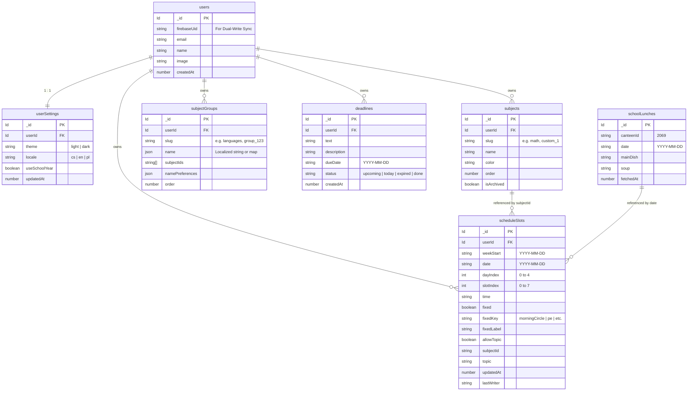
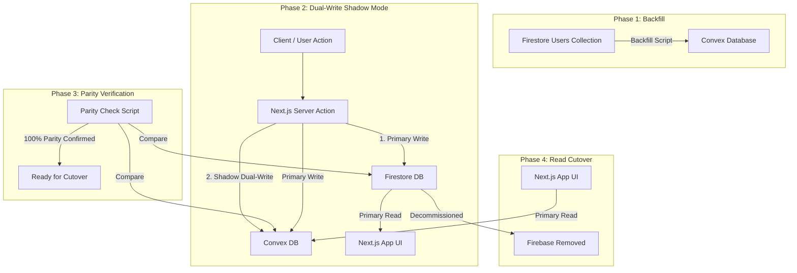

# Convex Migration Architecture & Scalable Database Schema

This document defines the complete architectural proposal, database schema, and phased zero-downtime migration strategy for transitioning **Random Next App (Eindex)** from its current monolithic Firestore structure to **Convex** (Database + Auth).

---

## 1. Context & Exact Application Domain Analysis

Based on the actual project codebase, the application domain consists of:

* **Locales (`lib/i18n/config.ts`)**: Supported locales are strictly `cs` (default), `en`, and `pl`.
* **Settings (`lib/settings/types.ts`)**: `theme` (`"light" | "dark"`), `locale` (`"cs" | "en" | "pl"`), `useSchoolYear` (`boolean`).
* **Subjects (`lib/schedule/types.ts` & `lib/schedule/labels.ts`)**:
  * 18 built-in subjects: `math`, `theater`, `conversation`, `physics`, `bio`, `chem`, `czech`, `spanish`, `music`, `obcanka`, `english`, `farm`, `it`, `history`, `geo`, `other`, `sp`, `art`.
  * User-created custom subjects with custom `name` and `color`.
* **Subject Groups (`lib/schedule/defaults.ts`)**:
  * 4 built-in groups: `languages`, `sciences`, `humanities`, `other`.
  * Custom groups supporting localized names (`Record<string, string>`) and `namePreferences`.
* **Fixed Slots (`lib/schedule/types.ts`)**:
  * 6 fixed activity keys: `morningCircle`, `currentEvents`, `lunch`, `tutor`, `pe`, `assembly`.
* **Slots & Timetable**:
  * Weekly grid with 5 days (Mon–Fri), each containing 5–8 slots (`time`, `fixed`, `fixedKey`, `fixedLabel`, `allowTopic`, `subjectId`, `topic`, `updatedAt`).
* **Deadlines**:
  * Items with `id`, `text`, `description`, `date` (`YYYY-MM-DD`), `status` (`"upcoming" | "today" | "expired" | "done"`).
* **Lunches**:
  * Scraped daily menus from `jidelna.cz` (Canteen ID 2069) merged with user overrides.

---

## 2. Why the Current Monolithic Firestore Model Fails at Scale

In Firestore, each user's state is stored as a single mega-document: `users/{userId}`.

```ts
// ❌ Monolithic Firestore structure:
users/{userId} = {
  state: {
    subjects: Subject[],
    subjectGroups: SubjectGroup[],
    weeks: {
      "2026-08-10": { weekStart, days: [ { date, slots: [ ... ] } ] },
      "2026-08-17": { ... },
      ... // Grows indefinitely week after week!
    },
    lunches: Record<string, string>,
    deadlines: DeadlineItem[]
  },
  settings: { theme, locale, useSchoolYear },
  updatedAt,
  lastWriter
}
```

### Critical Bottlenecks:
1. **Unbounded Growth**: A standard school year creates ~1,400+ slot objects. As weeks accumulate, the document balloons, increasing latency, memory consumption, and JSON parsing overhead.
2. **Read Inefficiency**: Loading "Today's Schedule" on the dashboard or checking one deadline requires downloading the entire multi-week historical state across the wire.
3. **Severe Write Contention**: Editing a single slot's topic (e.g., `"Exercise 4 on page 20"`) rewrites the *entire user document* inside a Firestore transaction. Concurrent edits from multiple tabs or devices cause race conditions and transaction conflicts.
4. **Subscription Overkill**: Any minor edit triggers a snapshot update on the entire user document, causing unnecessary React re-renders in unrelated UI components.
5. **No DB-Level Indexing or Filtering**: Deadlines cannot be queried by status or date range; everything must be filtered in memory.
6. **Data Duplication**: Shared canteen lunch menus are copied into every user's document.

---

## 3. Normalized Convex Entity-Relationship Diagram



---

## 4. Accurate Convex Schema Definition (`convex/schema.ts`)

```typescript
import { defineSchema, defineTable } from "convex/server";
import { v } from "convex/values";
import { authTables } from "@convex-dev/auth/server";

export default defineSchema({
  // Built-in authentication tables from @convex-dev/auth
  ...authTables,

  /**
   * Users Table Extension
   * Links Convex users with their legacy Firebase UID for seamless dual-write & backfill.
   */
  users: defineTable({
    name: v.optional(v.string()),
    email: v.optional(v.string()),
    image: v.optional(v.string()),
    emailVerificationTime: v.optional(v.number()),
    isAnonymous: v.optional(v.boolean()),
    firebaseUid: v.optional(v.string()), // Used during shadow dual-write phase
    createdAt: v.optional(v.number()),
  })
    .index("by_email", ["email"])
    .index("by_firebase_uid", ["firebaseUid"]),

  /**
   * User Settings & Preferences
   * Strictly matches APP_LOCALES (cs, en, pl) and DEFAULT_SETTINGS.
   */
  userSettings: defineTable({
    userId: v.id("users"),
    theme: v.union(v.literal("light"), v.literal("dark")),
    locale: v.union(v.literal("cs"), v.literal("en"), v.literal("pl")),
    useSchoolYear: v.boolean(),
    updatedAt: v.number(),
    lastWriter: v.optional(v.string()),
  })
    .index("by_user", ["userId"]),

  /**
   * Subjects
   * Contains built-in defaults and user-defined custom subjects.
   */
  subjects: defineTable({
    userId: v.id("users"),
    slug: v.string(), // e.g. "math", "czech", "custom_abc"
    name: v.string(), // e.g. "Matematika", "Čeština"
    color: v.string(), // Hex string e.g. "#b09ce3"
    order: v.optional(v.number()),
    isArchived: v.optional(v.boolean()),
    createdAt: v.number(),
    updatedAt: v.number(),
  })
    .index("by_user", ["userId"])
    .index("by_user_slug", ["userId", "slug"])
    .index("by_user_order", ["userId", "order"]),

  /**
   * Subject Groups
   * Groups subjects for filtering and stats (e.g. languages, sciences).
   */
  subjectGroups: defineTable({
    userId: v.id("users"),
    slug: v.string(), // e.g. "languages", "group_123"
    name: v.union(
      v.string(),
      v.record(v.string(), v.string()) // Localized name map: { cs: "Jazyky", en: "Languages", pl: "Języki" }
    ),
    subjectIds: v.array(v.string()), // Array of subject slugs
    namePreferences: v.optional(v.record(v.string(), v.string())),
    order: v.optional(v.number()),
    updatedAt: v.number(),
  })
    .index("by_user", ["userId"]),

  /**
   * Schedule Slots (Normalized Granular Model)
   * Represents individual timetable slots with specific day and period coordinates.
   */
  scheduleSlots: defineTable({
    userId: v.id("users"),
    weekStart: v.string(), // ISO Monday date (YYYY-MM-DD), e.g. "2026-08-10"
    date: v.string(), // ISO Day date (YYYY-MM-DD), e.g. "2026-08-12"
    dayIndex: v.number(), // 0 = Monday, 1 = Tuesday, ... 4 = Friday
    slotIndex: v.number(), // 0 to 7 (period of the day)
    time: v.string(), // e.g. "08:20-10:20"
    fixed: v.boolean(),
    fixedKey: v.optional(
      v.union(
        v.literal("morningCircle"),
        v.literal("currentEvents"),
        v.literal("lunch"),
        v.literal("tutor"),
        v.literal("pe"),
        v.literal("assembly")
      )
    ),
    fixedLabel: v.optional(v.string()),
    allowTopic: v.boolean(),
    subjectId: v.optional(v.union(v.string(), v.null())), // Subject slug, "lunch", or null
    topic: v.string(),
    updatedAt: v.number(),
    lastWriter: v.optional(v.string()),
  })
    // 1. Used by Planning Page to fetch exact 35 slots for a week:
    .index("by_user_week", ["userId", "weekStart"])
    // 2. Used by Dashboard to fetch today's/tomorrow's 5-8 slots:
    .index("by_user_date", ["userId", "date"])
    // 3. Used for O(1) single-slot updates:
    .index("by_user_slot_coord", ["userId", "weekStart", "dayIndex", "slotIndex"])
    // 4. Used for fast statistics aggregation without table scanning:
    .index("by_user_subject", ["userId", "subjectId"]),

  /**
   * Deadlines
   * Tasks and assignment reminders.
   */
  deadlines: defineTable({
    userId: v.id("users"),
    deadlineId: v.string(), // Original UUID
    text: v.string(),
    description: v.string(),
    date: v.string(), // ISO Due date (YYYY-MM-DD)
    status: v.union(
      v.literal("upcoming"),
      v.literal("today"),
      v.literal("expired"),
      v.literal("done")
    ),
    createdAt: v.number(),
    updatedAt: v.number(),
  })
    .index("by_user", ["userId"])
    .index("by_user_date", ["userId", "date"])
    .index("by_user_status", ["userId", "status"]),

  /**
   * School Lunches (Shared Canteen Table)
   * Scraped menu from jidelna.cz. Shared across all users.
   */
  schoolLunches: defineTable({
    canteenId: v.string(), // e.g. "2069"
    date: v.string(), // ISO Date (YYYY-MM-DD)
    menuText: v.string(),
    fetchedAt: v.number(),
  })
    .index("by_canteen_date", ["canteenId", "date"]),
});
```

---

## 5. Phased Zero-Downtime Migration Strategy

As requested, **Firebase remains the primary source of truth for the entire Next.js app until Convex is 100% verified.**



---

### Phase 1: Initial Data Backfill

A one-off migration script (`scripts/migrate-firestore-to-convex.ts`) connects to Firebase via `firebase-admin` and Convex via `ConvexHttpClient`.

#### Backfill Logic:
1. Fetch all documents from Firestore `users` collection.
2. For each user document:
   * Create/get Convex user record mapped by `firebaseUid`.
   * Insert `userSettings`: `{ theme, locale, useSchoolYear }`.
   * Insert `subjects`: All items from `state.subjects`.
   * Insert `subjectGroups`: All items from `state.subjectGroups`.
   * Insert `deadlines`: All items from `state.deadlines`.
   * Normalize and insert all `scheduleSlots` from all historical weeks in `state.weeks`.

---

### Phase 2: Dual-Write (Shadow-Write) Implementation

All Server Actions in `app/(app)/actions.ts` continue writing to Firestore first, and then fire a background shadow write to Convex. If Convex experiences any temporary network error during this phase, it is logged without interrupting the user's Firebase operation.

#### Dual-Write Server Helper (`lib/convex/dual-write.ts`):
```typescript
import "server-only";
import { ConvexHttpClient } from "convex/browser";
import { api } from "@/convex/_generated/api";

const convexUrl = process.env.NEXT_PUBLIC_CONVEX_URL;
const convexAdminKey = process.env.CONVEX_ADMIN_KEY;

export const convexClient = convexUrl ? new ConvexHttpClient(convexUrl) : null;

/**
 * Safely mirror a write to Convex in the background without blocking Firebase.
 */
export async function shadowWriteToConvex<T extends keyof typeof api.sync>(
  mutationName: T,
  args: any,
) {
  if (!convexClient) return;

  try {
    // @ts-ignore
    await convexClient.mutation(api.sync[mutationName], args);
  } catch (error) {
    console.error(`[Convex Shadow Write Error] ${String(mutationName)}:`, error);
  }
}
```

#### Example Dual-Write in Server Actions (`app/(app)/actions.ts`):
```typescript
export async function setSlotSubjectAction(
  input: SlotUpdateInput & { subjectId: string | null; writerId?: string },
) {
  const session = await requireSession();

  // 1. Primary Write to Firestore (Source of Truth)
  await updateUserState(
    session.uid,
    (state) => {
      const slot = getSlotForUpdate(state, input);
      if (!slot) return;
      if (slot.fixed && slot.fixedLabel.toLowerCase().includes("obed")) {
        slot.subjectId = "lunch";
      } else if (slot.fixed) {
        slot.subjectId = null;
      } else {
        slot.subjectId = input.subjectId || null;
        slot.updatedAt = Date.now();
      }
    },
    { writerId: input.writerId },
  );

  // 2. Dual-Write to Convex (Shadow Sync)
  void shadowWriteToConvex("syncSlotSubject", {
    firebaseUid: session.uid,
    weekStart: input.weekStart,
    dayIndex: input.dayIndex,
    slotIndex: input.slotIndex,
    subjectId: input.subjectId,
    updatedAt: Date.now(),
    writerId: input.writerId,
  });
}
```

---

### Phase 3: Data Parity Verification Script

Before flipping reads, run an automated consistency checker (`scripts/verify-parity.ts`) that verifies:
1. Total counts for users, subjects, deadlines, and schedule slots.
2. Slot topics and subject IDs match across all weeks for active users.
3. Settings (theme, locale, school year flag) match identically.

---

### Phase 4: Read Cutover & Convex Auth Activation

Once 100% parity is verified:
1. **Switch UI Reads to Convex Queries**:
   * Replace `getUserState()` in Server Components with Convex `fetchQuery(api.schedule.getWeekSchedule)`.
   * Replace `UserSyncProvider.tsx` Firestore snapshot with real-time `useQuery(api.settings.getUserSettings)`.
2. **Switch Authentication**:
   * Switch login panel to `@convex-dev/auth` Google OAuth.
   * Verify session tokens using `convexAuthNextjsToken()`.
3. **Turn Convex into the Primary Database**:
   * Mutations write directly to Convex.

---

### Phase 5: Decommission Firebase

1. Remove `firebase` and `firebase-admin` from `package.json`.
2. Delete `lib/firebase/client.ts` and `lib/firebase/admin.ts`.
3. Remove Firebase environment variables.

---

## 6. Comparison Summary

| Metric | Current (Firestore Monolith) | Proposed (Normalized Convex) |
| :--- | :--- | :--- |
| **Locales Supported** | `cs`, `en`, `pl` | `cs`, `en`, `pl` (Strictly validated) |
| **Document Boundary** | 1 monolithic document per user | 6 discrete, indexed tables |
| **Weekly Planning Read** | ~500 KB (All 40 weeks loaded) | ~4 KB (Only 35 slots for that week) |
| **Dashboard Daily Read** | ~500 KB | < 1 KB (Only 5–8 slots for today) |
| **Slot Topic Edit** | Rewrites entire 500 KB state object | Updates a single ~100-byte record |
| **Simultaneous Editing** | Transaction write conflicts | Conflict-free per-slot mutations |
| **Reactivity** | Full state invalidation | Granular document subscriptions |
| **Migration Risk** | High without staging | Zero (Shadow dual-write & parity checks) |
